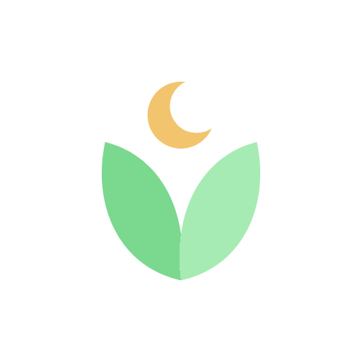

<div align="center">


[](https://git.io/typing-svg)

</div>

---

### 👤 Sobre mí

```js
const diego = {
  nombre: "Diego Avalos",
  ubicacion: "Lima, Perú 🇵🇪",
  rol: "Estudiante de Ingeniería de Sistemas de Información",
  universidad: "UPC",
  edad: 21,
  enfoque: ["desarrollo web", "arquitectura de software", "proyectos personales"],
  filosofia: "entender por qué funciona, no solo que funciona",
  meta: "llegar a un puesto real de ingeniería de software"
};
```

<div align="center">

   

</div>

<div align="center">


</div>

### 🧭 Cómo trabajo

<div align="center">

| | | |
|:---:|:---:|:---:|
| 🧠 **Entiendo antes de copiar** | 📱 **Responsive de serie** | ⚡ **Entrega rápida** |
| No uso código que no sepa explicar | Se ve bien en celular y desktop, sin excepciones | Sin vueltas ni demoras eternas |
| 🧹 **Código limpio** | 🔁 **Soporte post-entrega** | 💬 **Comunicación clara** |
| Pocas dependencias, fácil de mantener | Si algo necesita un ajuste, seguimos hablando | El costo y el alcance se hablan antes de empezar |

</div>

---

### 🛠️ Stack y herramientas

<div align="center">

**Lenguajes y web**

   

**Frontend y backend**

  

**Datos, cloud y control de versiones**

    

</div>

---

### 🚀 Proyecto destacado

<div align="center">


#### Vesper


</div>

Vesper es una **app web instalable (PWA)**, pensada para el celular, que convierte el repaso de lo aprendido en un **ritual nocturno antes de dormir**. El usuario crea sus propias preguntas y las repasa con **repetición espaciada**: las que peor recuerda vuelven a aparecer más seguido.

Al cerrar el día mantiene una racha de días consecutivos (con un escudo gratis por semana que perdona un día fallado) y hace crecer un árbol por etapas. También incluye **exámenes de 10 preguntas generados con Gemini**, medallas, perfiles públicos con canción, amigos, búsqueda de personas y recordatorios push.

<div align="center">

| | | |
|:---:|:---:|:---:|
| 📲 PWA instalable | 🔁 Repetición espaciada | 🤖 Exámenes con Gemini AI |
| 🔥 Rachas + escudos | 💎 Economía de diamantes | 🏅 Perfiles, amigos y medallas |

     

</div>

---

### 📊 Actividad en GitHub

<div align="center">

 

</div>

---

<div align="center">


📫 **diegoava20@gmail.com** · [🗂️ Portafolio](https://github.com/DevAvalos/portafolio)

<sub>construyendo mi camino como ingeniero, un proyecto a la vez</sub>

</div>
